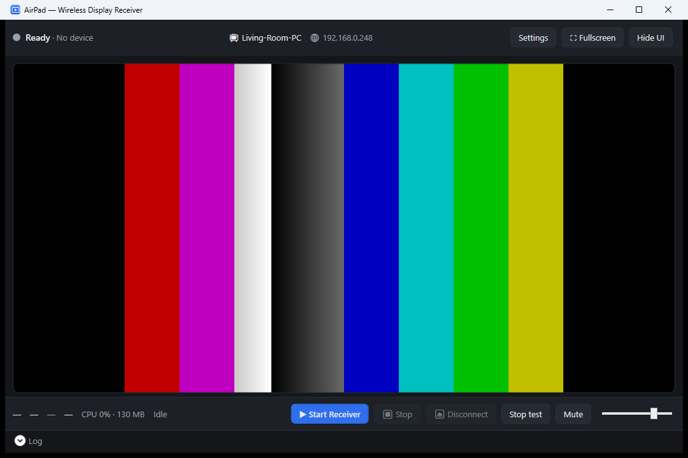

# AirPad

**Бездротовий екран для iPad і iPhone на Windows 10/11.** Відкрий AirPad на ПК, на iPad вибери
**Повторення екрана** — і екран iPad з'являється у вікні на комп'ютері, разом зі звуком.
Без Apple TV, без iTunes і Bonjour, без хмари: усе йде локальною мережею.

> **English:** AirPad turns a Windows 10/11 PC into an AirPlay screen-mirroring receiver for
> iPad and iPhone. Download the zip from [Releases](https://github.com/4bit33/AirPad/releases), run
> `AirPad.exe`, press **Start Receiver**, then pick the PC in **Control Center → Screen Mirroring**.
> Video and sound stay on your local network. Free software under the GNU GPL v3.



## Можливості

- **Стандартне AirPlay-дзеркалювання** — нічого не треба ставити на iPad.
- **Звук з iPad** через динаміки ПК; гучність синхронізується з кнопками iPad.
- **Низька затримка:** кадр іде з мережі одразу на екран, без буферів; декодування на GPU (D3D11VA) або CPU.
- **Повороти екрана** portrait/landscape підхоплюються автоматично.
- **Повний екран** (F11) і режим без панелей (Ctrl+H) — зручно для проєктора чи другого монітора.
- **Автозапуск з Windows:** ПК видно в «Повторенні екрана» одразу після входу в систему.
- Працює без Bonjour, без iTunes і без доступу до інтернету.

## Встановлення

1. Завантаж `AirPad-<версія>-win-x64.zip` з [Releases](https://github.com/4bit33/AirPad/releases)
   і розпакуй у будь-яку папку. Встановлювати .NET не треба: усе вже всередині.
2. Запусти `AirPad.exe`.
   - Якщо Windows покаже «Windows захистила ваш ПК» — натисни **Докладніше → Все одно запустити**.
     Так буває з будь-якою програмою без платного цифрового підпису.
   - Якщо Windows спитає про доступ до мережі — дозволь для **приватних мереж**.
3. Натисни **▶ Start Receiver**.
4. На iPad, у тій самій Wi-Fi мережі: **Пункт керування → Повторення екрана → назва твого ПК**.

Налаштування зберігаються в `%APPDATA%\AirPad\settings.json`, логи — в `%APPDATA%\AirPad\logs`.
Щоб видалити AirPad, достатньо видалити його папку і (за бажання) `%APPDATA%\AirPad`.

## Керування

| Дія | Як |
|---|---|
| Повний екран | **F11** або кнопка **Fullscreen** |
| Сховати / показати панелі | **Ctrl+H** або **Hide UI** |
| Вийти з обох режимів | **Esc** |
| Розірвати з'єднання з iPad | **⏏ Disconnect** (приймач лишається видимим) |
| Перевірити, що відео в програмі працює, без iPad | **Test pattern** |

У **Settings**: назва ПК, яку бачить iPad, автозапуск з Windows, повний екран при підключенні,
апаратне декодування, ліміт FPS, масштабування (Fit / Fill / Stretch), звук, рівень логів, порти.

## Якщо iPad не бачить ПК

1. iPad і ПК мають бути **в одній мережі** — не в гостьовій Wi-Fi і не в різних роутерах.
2. Натисни **Settings → Fix Windows Firewall** (попросить права адміністратора)
   або запусти `setup-firewall.ps1` з архіву від імені адміністратора.
3. Вимкни VPN на iPad. Якщо роутер ізолює Wi-Fi-клієнтів (AP / client isolation), вимкни цю опцію в його налаштуваннях.
4. Перезапусти приймач (**Stop → Start Receiver**) і вимкни/увімкни Wi-Fi на iPad.

Більше — у [docs/DEBUGGING.md](docs/DEBUGGING.md): чорний екран, немає звуку, затримка, зависання.

## Обмеження

- **DRM-контент** (Apple TV+, Netflix тощо) iPad стороннім приймачам не віддзеркалює — буде чорний прямокутник.
- Режим «відео на ТБ» (коли YouTube передає лише відео, а не весь екран) не підтримується —
  тому AirPad його й не заявляє, і застосунки дзеркалять екран як звичайно.
- Лише Windows 10 1809+ / 11, x64.
- Перевірено з iPad Pro 11″ (4-го покоління) на iPadOS 27.

## Збірка з вихідного коду

Потрібен [.NET 10 SDK](https://dotnet.microsoft.com/download).

```powershell
dotnet build AirPad.slnx -c Release
dotnet test AirPad.slnx -c Release
powershell -ExecutionPolicy Bypass -File scripts\get-ffmpeg.ps1   # FFmpeg DLL поруч з exe
.\src\AirPad\bin\Release\net10.0-windows\AirPad.exe
```

Готовий архів для релізу: `scripts\publish.ps1` → `publish\AirPad-<версія>-win-x64.zip`.
Деталі — у [docs/BUILD.md](docs/BUILD.md).

## Як це влаштовано

AirPad реалізує той самий протокол, що й Apple TV: оголошує себе в мережі через mDNS,
проходить pairing і FairPlay-handshake, розшифровує H.264-відео (AES-CTR) і AAC-ELD-звук,
декодує їх через FFmpeg і малює кадри у WPF-вікні.

```
src/AirPad.Core/     логіка приймача без UI: mDNS, RTSP/HTTP, pairing, FairPlay, мережа, декодери, аудіо
src/AirPad/          WPF-застосунок (MVVM): головне вікно, налаштування, рендер
tests/               unit- та інтеграційні тести
scripts/             FFmpeg, firewall, збірка релізу
docs/                протокол, архітектура, збірка, діагностика
```

- [docs/PROTOCOL.md](docs/PROTOCOL.md) — протокол: discovery, порти, pairing, сесії, формати, синхронізація
- [docs/ARCHITECTURE.md](docs/ARCHITECTURE.md) — компоненти, потоки даних, стани
- [docs/BUILD.md](docs/BUILD.md) — збірка, тести, публікація, залежності
- [docs/DEBUGGING.md](docs/DEBUGGING.md) — типові проблеми і діагностика

## Безпека та приватність

- Приймаються лише підключення з локальної мережі; зовнішні адреси відкидаються одразу.
- Нічого не надсилається в інтернет. Паролі й ключі не зберігаються — сесійні ключі живуть лише в пам'яті.
- Firewall відкриває тільки потрібні порти: TCP 5000/7000, UDP 5353/7002/7003.

## Подяки

- [playfair](https://github.com/EstebanKubata/playfair) (EstebanKubata, GPL-3.0) — FairPlay-процедура,
  з якої розшифровується ключ відеопотоку (`src/AirPad.Core/Auth/FairPlay`).
- [SteeBono/airplayreceiver](https://github.com/SteeBono/airplayreceiver) (MIT) — C#-порт playfair,
  plist-кодек, моделі RTSP.
- Binary plist — Chad Burggraf (Tasty Codes), на основі BinaryPListParser Werner Randelshofer.
- Документація й референси: [UxPlay](https://github.com/FDH2/UxPlay),
  [openairplay](https://openairplay.github.io/airplay-spec/),
  [Emanuele Cozzi — AirPlay 2 Internals](https://emanuelecozzi.net/docs/airplay2/).
- Бібліотеки: [FFmpeg](https://ffmpeg.org) (LGPL), FFmpeg.AutoGen, NAudio, BouncyCastle, Makaretu.Dns.Multicast.

AirPlay, iPad і iPhone — торговельні марки Apple Inc. AirPad не пов'язаний з Apple.

## Ліцензія

Copyright (C) 2026 4bit33

AirPad — вільне ПЗ під [GNU GPL v3](LICENSE): його можна використовувати, змінювати й поширювати,
але похідні версії мають лишатися відкритими під тією ж ліцензією, зберігати цей копірайт і позначати
внесені зміни. GPL-3.0 тут обов'язкова, бо код FairPlay походить з playfair (GPL-3.0).
